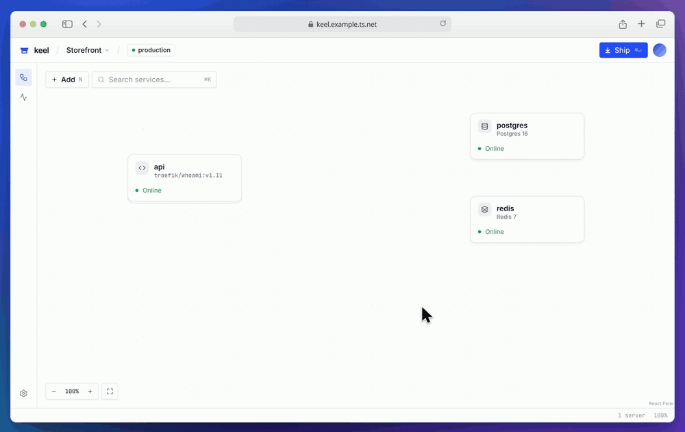

# Keel

Self-hosted deploy platform. An alternative to Coolify and Dokploy, built around the UI and the deploy experience.



- **Canvas first.** A project is a canvas: services, databases and caches are nodes, and variables wire them together.
- **Multi-server by default.** Docker Swarm under the hood; a single server is a first-class cluster.
- **Almost no networking for you.** Servers and containers talk over [Tailscale](https://tailscale.com). Public traffic enters through one proxy with automatic HTTPS: you open ports 80 and 443, and that is the whole job.
- **Made for agents too.** The installer and the `keel` CLI run unattended and answer in JSON.

> Early and moving fast. Expect breaking changes before 1.0.

## Install

On a fresh Linux server (amd64 or arm64, 2 GB RAM or more):

```bash
curl -fsSL https://raw.githubusercontent.com/ThallesP/keel/main/install.sh | sudo bash
```

You need a Tailscale account (the free plan works). If the server isn't on your tailnet yet, the installer prints a login link and waits. When it finishes, it prints the dashboard URL: open it from any device on your tailnet and sign up. The first account owns the install.

To put services on the internet, let ports 80 and 443 reach the server. The dashboard stays tailnet-only either way.

Run the same command again to upgrade. Options, what the installer touches, uninstalling, troubleshooting and running it from an agent are in [docs/install.md](docs/install.md).

## CLI

Deploy from a terminal, or let your agent do it. `keel` is the same binary that runs the control plane.

```bash
keel login https://keel.example.ts.net          # prints a link; approve it in the dashboard
keel service create api --image ghcr.io/acme/api:1.4 --port 3000
keel var set api LOG_LEVEL=debug
keel ship                                       # deploy staged changes, wait for the result
keel logs api
```

Commands and the output contract are in [docs/cli.md](docs/cli.md).

## Docs

- [Install](docs/install.md): installer steps, options, upgrade, uninstall, the JSON contract for agents
- [CLI](docs/cli.md)
- [Development](docs/development.md): run Keel locally, repo layout, CI
- Design: [canvas](docs/canvas.md), [workers](docs/workers.md), [networking](docs/networking.md), [volumes](docs/volumes.md), [logs and traces](docs/logs.md), [agents](docs/agents.md)

## Community

Questions, ideas or just want to talk? Come say hi on [Discord](https://discord.gg/pF5wfWZMSH).

## License

[MIT](LICENSE)
